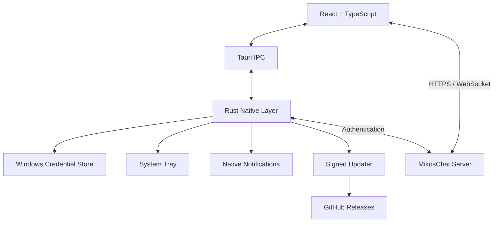

<div align="center">


# MikosChat Desktop

**Your conversations. Your desktop. Your freedom.**

The official desktop client for MikosChat — a modern, open-source messaging ecosystem.

[](LICENSE)
[](#installation)
[](https://tauri.app)
[](#project-status)

[](https://github.com/Matisiowy/MikosChat-Desktop/actions)
[](https://github.com/Matisiowy/MikosChat-Desktop/stargazers)
[](https://github.com/Matisiowy/MikosChat-Desktop/issues)

[Website](https://chat.mikrusmusic.pl) |
[Downloads](https://github.com/Matisiowy/MikosChat-Desktop/releases) |
[Web Client](https://github.com/Matisiowy/MikosChat-Web) |
[Server](https://github.com/Matisiowy/MikosChat-Server)

</div>

---

## About

MikosChat Desktop brings the MikosChat messaging experience directly to your computer.

Built with Tauri, Rust and React, it combines a modern interface with native Windows integration, without bundling an entire Chromium browser.

Our vision is to build an accessible, independent and transparent communication platform.

## Features

| Feature | Description |
| :--- | :--- |
| Real-time messaging | Instant direct and group conversations |
| Rich conversations | Replies, reactions, editing and message deletion |
| Multimedia | Images, videos, audio and file attachments |
| Message search | Find messages within conversations |
| Social features | Friends, profiles and online presence |
| Native notifications | Receive Windows desktop notifications |
| System tray | Stay connected when the main window is closed |
| Autostart | Launch automatically with Windows |
| Persistent sessions | Native credential storage for remembered sessions |
| Signed updates | Cryptographically verified update mechanism |
| Modern interface | Responsive dark UI shared in design with the web client |

## Technology stack

<div align="center">


</div>

## Architecture



## Installation

### Windows

Once binaries are published, download a Windows x64 installer from the [Releases](https://github.com/Matisiowy/MikosChat-Desktop/releases) page.

| Package | Format |
| :--- | :--- |
| Standard installer | EXE / NSIS |
| Windows Installer | MSI |

Microsoft Edge WebView2 Runtime is required.

Early builds may display Windows SmartScreen warnings because Authenticode signing is not yet configured.

## Development

### Prerequisites

- Node.js 24
- Rust stable
- Microsoft Visual Studio C++ Build Tools
- Windows SDK
- Microsoft Edge WebView2

### Getting started

```powershell
git clone https://github.com/Matisiowy/MikosChat-Desktop.git
cd MikosChat-Desktop
npm ci
npm run tauri dev
```

The official client currently connects to the hosted MikosChat API. Custom server configuration requires source changes.

### Validation

```powershell
npm run build
cd src-tauri
cargo fmt --check
cargo check --locked
cargo clippy --locked -- -D warnings
cargo test --locked
```

### Production build

```powershell
npm run tauri build
```

Signed release builds require the project signing credentials.

Installers are generated in:

```text
src-tauri/target/release/bundle/nsis/
src-tauri/target/release/bundle/msi/
```

## Project structure

```text
MikosChat-Desktop/
├── .github/          GitHub Actions
├── public/           Static assets and branding
├── scripts/          Build and version utilities
├── src/              React application
│   ├── api/          API and native authentication
│   ├── components/   User interface
│   ├── hooks/        Application lifecycle
│   ├── services/     Native integrations
│   └── stores/       Application state
└── src-tauri/        Rust native application
    ├── capabilities/ Native permissions
    ├── icons/        Application icons
    └── src/          Native implementation
```

## Roadmap

- [x] Native desktop application
- [x] Real-time messaging
- [x] Persistent authentication
- [x] Windows credential storage
- [x] Native notifications
- [x] System tray integration
- [x] Windows autostart implementation
- [x] NSIS and MSI installers
- [x] Signed updater implementation
- [ ] Production update verification
- [ ] Automated release publishing
- [ ] Voice calls
- [ ] Video calls
- [ ] Screen sharing
- [ ] End-to-end encryption
- [ ] macOS and Linux support

## Security

Remembered refresh credentials are stored using native credential storage rather than browser local storage.

Updates are designed to be verified using the embedded public signing key.

Private signing keys and passwords must never be committed to the repository.

MikosChat is currently in alpha. End-to-end encryption is not yet implemented.

Please report security vulnerabilities privately rather than opening public issues containing exploit details.

## Ecosystem

| Repository | Description |
| :--- | :--- |
| [MikosChat Desktop](https://github.com/Matisiowy/MikosChat-Desktop) | Native desktop client |
| [MikosChat Web](https://github.com/Matisiowy/MikosChat-Web) | Browser-based client |
| [MikosChat Server](https://github.com/Matisiowy/MikosChat-Server) | Messaging backend |

## Contributing

Contributions, bug reports and feature suggestions are welcome.

Open an issue or submit a pull request with a clear description of your changes.

## Project status

> [!NOTE]
> MikosChat is under active development. Alpha releases may contain bugs, incomplete features and breaking changes.

## License

Licensed under the [GNU Affero General Public License v3.0](LICENSE).

---

<div align="center">

**MikosChat**

Open communication. Independent infrastructure.

Developed by [Matisiowy](https://github.com/Matisiowy)

Copyright © 2026 MikosChat contributors.

</div>